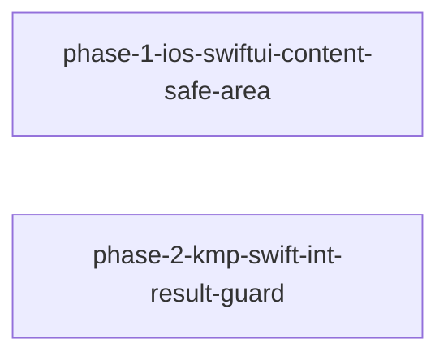

# iOS の安全領域と KMP の Int の結果

ColorAnalyzer の KMP 移植で見つかった iOS の 2 つの点を直し、利用者側の回避策が要らない状態にする。

## ゴール / 非ゴール

ゴール:
- iOS の器に載せた SwiftUI の中身 (Dialog・Loading・Toast) が、器と安全領域の重なりを SwiftUI 標準の安全領域として受け取れる (ios/ADR-0002)
- Dialog の KMP 向け Swift 面で、結果型に `Int` / `UInt` を指定するとコンパイル時の警告が `Int32` / `Int64` (`UInt` なら `UInt32` / `UInt64`) を案内し、show が型付きの失敗になる (2026-10-20 改訂: Swift には案内付きのコンパイルエラーにする仕組みが無いため)
- 2 つの変更が蒸留され、concepts が新しい挙動と型の対応を記述している

非ゴール:
- Android 側の変更。Android の器の中の Compose の中身から insets がどう見えるかは調べるが、差があっても起票に留める
- Sample へのデモの追加 (4 ルートに広がるため)。フェーズ 1 の挙動は自動テストと Simulator での実測で確かめる
- ColorAnalyzer 側の回避策 (`WindowSafeArea.swift`・`Int32` の書き方) の撤去 (別リポジトリ)
- `skills/` と README の更新 (蒸留の後に docs-refresh で追従する)
- version の決定とリリース

## 前提 / 制約

- 起票元: `../ColorAnalyzer/kasane/roadmaps/kmp-migration/autopilot-log.md` (ColorAnalyzer の KMP 移植の自律実行、2026-10-20)。探索 (2026-10-20) の結果は各フェーズの agenda に取り込んだ
- ios/ADR-0002 は proposed。フェーズ 1 の実測で器のサイズ計算が崩れたら、独自の値で渡す案 (B) に倒し、ADR を書き直す
- フェーズ 2 は kmp/ADR-0004 の方向の内側の変更で、ADR を新設しない。`Int` / `UInt` を結果型にしていたコードの show が型付きの失敗になるため (以前は Kotlin 側の `ClassCastException`)、`main` に入れる PR の `## Changes` には `- breaking:` として書く
- 統合確認: ios/ の Simulator での全件テスト・kmp/ の `allTests`・`scripts/scenario-id-coverage.py`。kmp/ のビルドは ios/ を取り込むため、どちらのフェーズでも両方を回す
- 2 フェーズはソースもテストも重ならない

## 全体図

## フェーズ一覧

| ID | 状態 | 種別 | フェーズ詳細 | Change |
|---|---|---|---|---|
| phase-1-ios-swiftui-content-safe-area | completed | change | [agenda](phases/phase-1-ios-swiftui-content-safe-area/agenda.md) | [deliver-swiftui-content-safe-area-ios](../../changes/archive/2026-10-20-deliver-swiftui-content-safe-area-ios/) |
| phase-2-kmp-swift-int-result-guard | in-progress | change | [agenda](phases/phase-2-kmp-swift-int-result-guard/agenda.md) | — |
